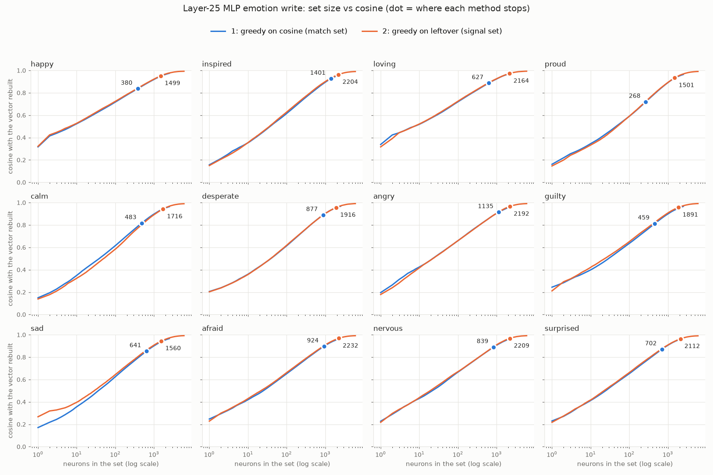

# Signal set and cancelling rest

Date: 2026-11-20. Branch: `stack/06-raw-sets`. Tag: `exp/residual_sets`. Status: kept.

Config: `configs/residual_sets.yaml`. Results: `results/residual_sets/residual_sets.json`.

```
python scripts/residual_sets.py --config configs/residual_sets.yaml --device cpu   # CPU, 30 s, from the signal_noise cache
```

## Question

- Can the neurons be split into a signal set S that rebuilds the emotion write, and a rest that cancels to zero?
- "Rebuilds" means direction and length: the leftover `|d - sum_S u_n| / |d|` is small. The leftover is exactly the rest's sum.

## Method

- Target: `d = W_down (abar_own - abar_other)`, raw story-mean activations, train stories. Other = 11 emotions and neutral.
- Greedy (`decomposition.residual`): add the neuron that shrinks the leftover most.
- Stop: where the leftover reaches the train gap's own sampling noise (0.24 to 0.37 of its length).
  - Past that point the set fits story noise.
- Held-out: the rest's held-out sum against the noise floor (what it would be if the rest summed to exactly zero).
- Controls: random sets of the same size; the match sets.

## Results

| | signal set at the noise level | random set, same size | match set |
|---|---|---|---|
| neurons | 1499 to 2232 (12% to 18%) | same | 268 to 1401 |
| leftover on train | 0.24 to 0.37 (= noise) | 0.88 to 0.93 | 0.50 to 0.76 |
| held-out leftover / noise floor | 1.06 to 1.41 (mean 1.19) | | |
| held-out cosine with the gap | 0.72 to 0.90 | | |
| write from pole tokens | 0.65 to 0.76 | | |

- Leftover by set size (happy): 100 neurons 0.69, 300 0.58, 1000 0.40, 3000 0.19.
- **The split exists, but the signal set is not small.** About 1900 neurons (15%) rebuild the write to its noise level.
- **The rest (about 10,400 neurons) cancel in most directions, but not along the emotion axis.** See the 6-fold check.
- **The match sets are not signal sets.** They point the right way but leave 50% to 76% of the write in the rest.
- The signal set's write comes 65% to 76% from pole tokens.

## 6-fold check: does the rest cancel?

- Every story is held out once (6 folds, as `crossval.py`). Per fold: the signal set at the train noise level.
- On the held-out stories, two measures of the rest's sum:
  - as a whole vector: its size against the noise floor;
  - along the train write's direction: its share of the held-out push, and its z against story noise (z combined over folds: sum / sqrt 6).

| emotion | signal set (mean over folds) | rest: vector size / noise floor | rest: share of the push along the emotion direction | z |
|---|---|---|---|---|
| happy | 1572 | 1.29 | 0.15 | 20 |
| proud | 1505 | 1.38 | 0.23 | 24 |
| sad | 1552 | 1.05 | 0.21 | 23 |
| angry | 2246 | 1.15 | 0.14 | 27 |
| all 12 | 1505 to 2288 | 1.05 to 1.38 | 0.11 to 0.23 | 20 to 27 |

- **As a whole vector, the rest looks like noise** (1.05 to 1.38 times the floor).
  - Noise is spread over 4096 dimensions, so it hides a weak push in one direction.
- **Along the emotion direction, the rest still pushes.** It carries 11% to 23% of the held-out push, far above story noise (z 20 to 27).
- So the split is: about 1900 neurons carry about 85% of the push. The other 10,400 cancel in every direction except the emotion axis, where together they add the last 15%.
  - This matches `signal_noise.md`: the weak neurons just below the significance cut carry 24% of the contrast.

## Limits

- Only 20 held-out stories per emotion in the single split. The held-out gap is about half noise (0.48 to 0.68 of its length).
- Greedy is not guaranteed optimal.
- The first 6-fold run gave NaN on 4 of 72 folds. A rerun gave finite values with the same numbers elsewhere. It was a numerical fault on the Mac CPU, not in the data.

## Set size vs cosine, both methods (`scripts/plot_set_curves.py`)



- Each method is scored against its own target.
- **The two greedy searches trace almost the same curve.** The order in which they add neurons is nearly the same.
- **They differ only in where they stop.**
  - Method 1 stops where the held-out cosine matches the whole MLP: cos 0.72 to 0.93, 268 to 1401 neurons.
  - Method 2 stops at the noise level: cos 0.93 to 0.97, 1499 to 2232 neurons.
- **There is no elbow.** The cosine rises about linearly with log(set size), from 1 neuron to about 2000.
  - So no small core carries the write, with the rest adding little. Each doubling of the set adds about the same.
